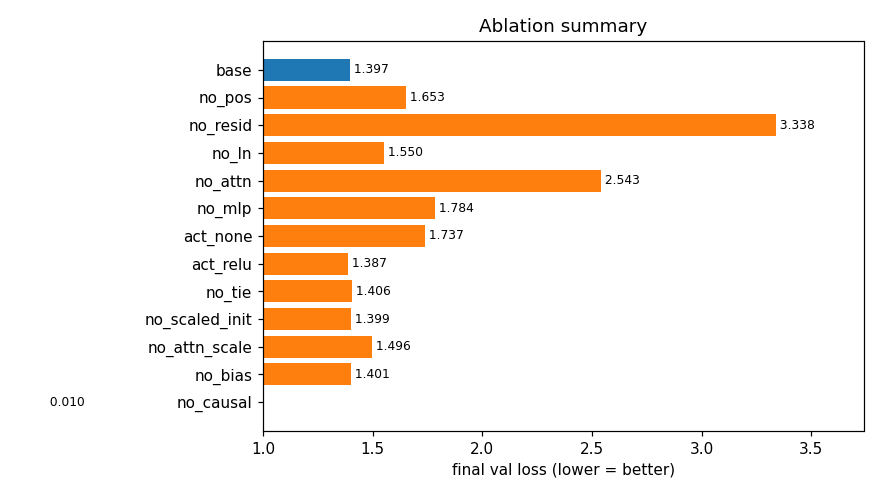
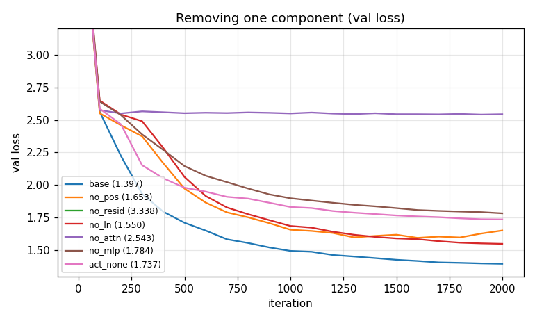
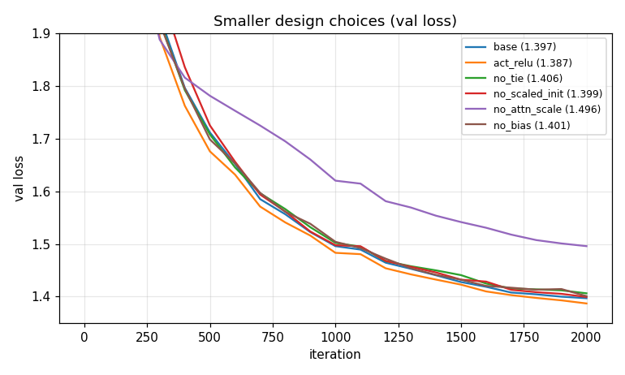
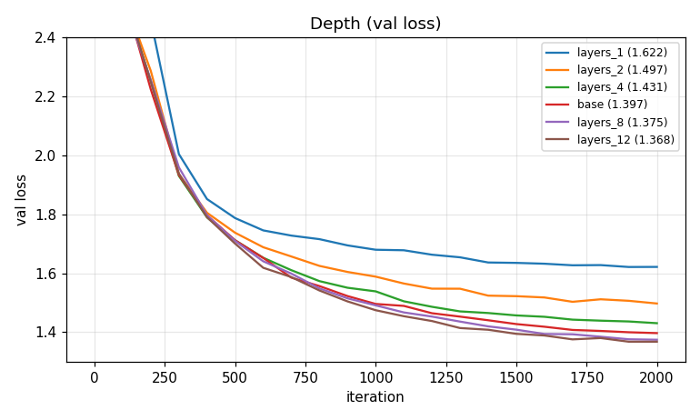
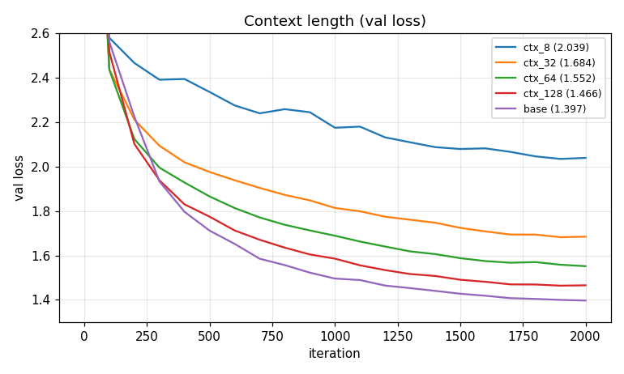
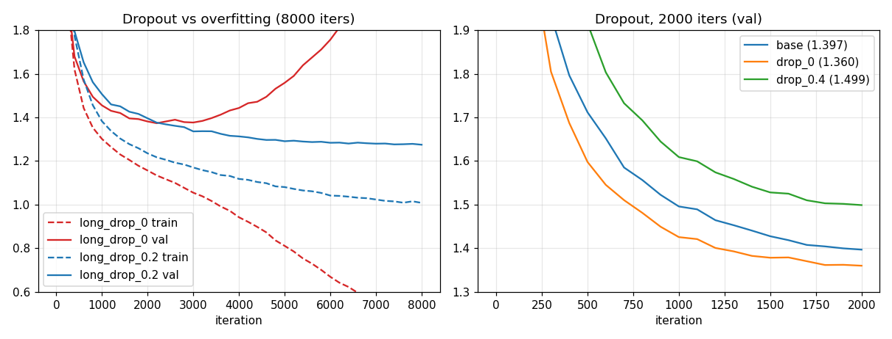
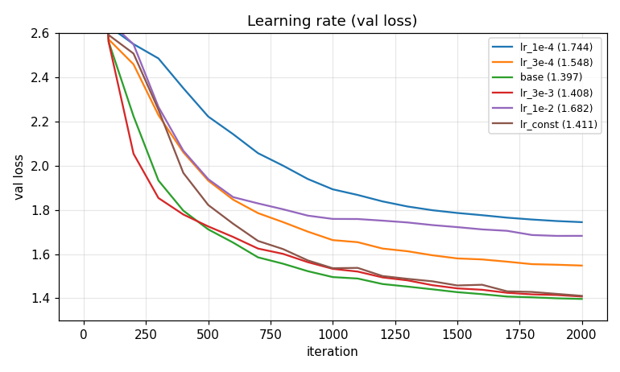

# Understanding nanoGPT's `model.py` — a hands-on tutorial (branch `shawn`)

Everything here was run on **one NVIDIA A100-SXM4-80GB** (torch 2.5.1, bf16 autocast). Nothing in `model.py` / `train.py` was modified;
all experiments use a flag-controlled copy of the model (`ablation_model.py`) that is **verified identical** to `model.py`
at default flags (same 10,679,808 params, same loss to 1e-6 — `check_equivalence.py`).

| file | what it is |
|---|---|
| `walkthrough.py` → `walkthrough_output.txt` | runnable, tiny-example tour of every part of `model.py` (Part 1 below) |
| `ablation_model.py` | `model.py` with a switch per technique |
| `run_experiment.py`, `run_all.sh` | trainer + the 40 experiments (≈1 min each) |
| `bench_speed.py` | flash-attention / bf16 / `torch.compile` speed tests |
| `make_report.py` → `plots/`, `results_table.md`, `results/*.json` | plots, full table, raw logs |

Reproduce: `python ../data/shakespeare_plays/prepare.py <dir with *_gut.txt>` → `python walkthrough.py` → `bash run_all.sh` → `python bench_speed.py` → `python make_report.py`.

> **Dataset note.** `raw.githubusercontent.com` is blocked from this Bolt session, so tinyshakespeare could not be downloaded.
> I instead built a char-level dataset from the Gutenberg Shakespeare plays shipped in the PyPI package `shakespeare==0.6`
> (`data/shakespeare_plays/prepare.py`): 42 plays, 5.06M chars, vocab 84, 4.55M train / 0.51M val.
> Val = the *last* plays alphabetically (unseen plays), so val loss measures generalisation to new plays.
> Absolute numbers are therefore **not comparable** with the usual tinyshakespeare ~1.47 figure.

## Experimental setup (the "baby GPT", same recipe as `config/train_shakespeare_char.py`)
6 layers, 6 heads, n_embd 384, context 256, dropout 0.2, bias=True, 10.68M params. AdamW (lr 1e-3, β2=0.99, wd 0.1), 100 warm-up steps then cosine to 1e-4,
grad-clip 1.0, batch 64×256 = 16,384 tokens/iter, **2000 iters** (≈33M tokens ≈ 7 epochs), eval = mean of 50 batches. Loss is in nats per character
(uniform guess = ln 84 = 4.43; we start at 4.50). **Baseline val loss = 1.397.**

**How much to trust a difference?** I ran the baseline with 3 seeds: 1.397 / 1.399 / 1.395 → noise ≈ **±0.003**. Everything else is *one* seed, so
treat differences below ~0.01 as "no measurable effect". This is a small-scale, short-training study; effects of subtle tricks (tying, init, bias) can
differ at GPT-2 scale and billions of tokens.

---
# Part 1 — `model.py` step by step

Run `python walkthrough.py` to see all of the following printed with real numbers (`walkthrough_output.txt`).

### Step 1 — Text → ids → (input, target) pairs
Characters (here) or BPE tokens (GPT-2) become integers. The target is the input shifted by one: for `"To be"` the pairs are `T→o`, `To→' '`, `To →b`, `To b→e`...
One sequence of length T yields **T training examples at once**; this is what makes transformers cheap to train.

### Step 2 — Embeddings (`GPT.forward`, lines 177-179)
`tok_emb = wte(idx)` is `(B,T,C)`; `pos_emb = wpe(arange(T))` is `(T,C)`, broadcast-added. Attention itself is permutation-invariant, so **without wpe the model has no idea of order**.
Example from the walkthrough: the space char at t=2 and t=6 has identical `wte` rows but different `wpe` rows, so after the sum the model can tell them apart.

### Step 3 — LayerNorm (lines 18-27) and pre-norm placement
Normalises each token vector to mean 0 / std 1 (walkthrough: mean 3.86, std 2.92 → 0.00, 1.00), then applies a learned gain (and optional bias).
nanoGPT is **pre-norm**: `x = x + attn(ln_1(x))`. The residual path itself is never normalised.

### Step 4 — Causal self-attention (lines 29-76)
One `Linear(C, 3C)` produces Q, K, V for all heads at once; `view(B,T,nh,hs).transpose(1,2)` makes the head a batch dimension `(B,nh,T,hs)`.
Per head: `scores = QKᵀ/√hs` → `(T,T)`; upper triangle set to −inf (causal mask); softmax; `weights @ V`; heads re-concatenated; `c_proj`.
The walkthrough computes this **by hand for T=4** and matches `CausalSelfAttention` to 3e-8. Real attention weights from that run (head 0):
```
[[1.000 0.000 0.000 0.000]     token 0 can only see itself
 [0.492 0.508 0.000 0.000]     token 1 mixes tokens 0,1
 [0.293 0.477 0.229 0.000]
 [0.222 0.227 0.400 0.151]]    token 3 mixes all four; every row sums to 1
```
Why `/√hs`? For hs=64, `q·k` has std **8.05** unscaled vs **1.01** scaled (walkthrough) — unscaled scores make softmax saturate (one-hot), which kills gradients.
The `flash` path (`scaled_dot_product_attention`) computes the same thing in a fused kernel without ever materialising the T×T matrix.

### Step 5 — Proof of causality
Editing the token at t=5 changes logits only at positions ≥5 (`|Δlogits|` = 0,0,0,0,0,0.48,0.01,0.007). This is what lets one forward pass safely train on all T positions.

### Step 6 — MLP and Block (lines 78-106)
MLP: `Linear(C,4C) → GELU → Linear(4C,C)`. **Attention lets tokens talk to each other (mixes across T); the MLP lets each token think on its own (mixes across C).** 65.8% of all parameters are MLP, 32.9% attention (walkthrough Step 7).
Block = two residual updates: `x += attn(ln(x)); x += mlp(ln(x))`. Think of `x` as a "residual stream" that every layer reads from and adds to.

### Step 7 — The whole model (lines 118-193)
Embeddings → `n_layer` Blocks → final LayerNorm → `lm_head` (C→vocab) → cross-entropy against the shifted targets. Loss at init is 4.52 ≈ ln(84)=4.43: the small init (std 0.02) makes logits near-uniform, a useful sanity check ("if your initial loss isn't ≈ ln(vocab), something's wrong").
At inference only the last position is passed through `lm_head` (line 190) – a free speedup.

### Step 8 — Initialisation details (lines 138-145)
* **Weight tying** `wte.weight = lm_head.weight`: input and output token vectors are shared. Saves V·C params (here 32K; for GPT-2 124M it's 38.6M = 31%).
* **Scaled residual init**: every `c_proj` gets std `0.02/√(2·n_layer)`, because 2·n_layer sublayers add into the residual stream. Walkthrough, std of the stream after the last block at init:

  | n_layer | scaled | unscaled |
  |---|---|---|
  | 6 | 0.144 | 0.491 |
  | 24 | 0.141 | 1.036 |

  Scaled keeps it constant in depth; unscaled grows with depth.

### Step 9 — Optimizer groups (lines 263-287)
Weight decay only on tensors with ≥2 dims (matmul weights, embeddings): 26 tensors / 10.75M params decayed; 50 tensors / 30.7K params (biases, LN gains) not. Fused AdamW on CUDA.

### Step 10 — Sampling (`generate`, lines 305-330)
Autoregressive: crop to `block_size`, forward, take the **last** position's logits, `/temperature`, optional top-k, softmax, sample, append. Walkthrough on logits `[3,2,1,0,-1]`:
T=0.5 → p(top)=0.865; T=1 → 0.636; T=2 → 0.429. top_k=2 → `[0.73, 0.27, 0, 0, 0]` — tail tokens can never be sampled.
A sample from our baseline (2000 iters, ~1 minute of training) already has play structure — speaker names, verse-like lines, mostly valid words:
```
FALSTAFF.
What is the door? the feast is my Grey's noble arm that I will none
her shall be success so.
```

---
# Part 2 — What does each technique buy? (experiments)

Final val loss after 2000 iters, baseline **1.397** (±0.003). Δ>0 = worse. Full table: `results_table.md`; curves: `plots/`.



## 2.1 Components that are essential (remove one → big loss)
| removed | val | Δ | what happened / why |
|---|---|---|---|
| **residual connections** | 3.338 | **+1.94** | Does not learn beyond character frequencies: 3.338 vs **3.329 for a pure unigram model** (computed from train counts on val). Likely cause: gradients must pass through 12 sublayers with no shortcut and each layer must re-create its whole input (mechanism not separately tested). |
| **attention** (MLP only) | 2.543 | **+1.15** | Flat from iteration ~200: each position sees only its own token, so it can only learn which character tends to follow the current one (bigram-level). Context is the whole point. |
| **MLP** (attention only) | 1.784 | +0.39 | Trains but plateaus; attention only *moves* information between positions (linear mixing of values), the MLP supplies per-token non-linear computation. |
| **non-linearity** (GELU→identity) | 1.737 | +0.34 | With no activation the MLP collapses to one linear map; the model gets weaker even though it has the same parameters. ReLU instead of GELU: 1.387 (Δ−0.010, ≈ noise-level → either works at this scale). |
| **positional embedding** | 1.653 | +0.26 | Without order information, attention only sees a *bag* of earlier characters (causal masking leaks a little positional info, which is why it's not worse). Curve (`plots/ablate_components.png`) is also noisier: best 1.596 at it≈1300, then drifts up to 1.653. |
| **LayerNorm** | 1.550 | +0.15 | Still trains (small net, only 6 layers, small init) but converges more slowly. Pre-LN matters more as depth and learning rate grow. |



## 2.2 The causal mask: a cautionary tale about "great" val loss
Removing the mask gives **val loss 0.0097** (train 0.0098) – absurdly low, and *not* a better model: position t can attend to position t+1, which **is the target**.
The model learns to copy the next input character. At generation time the future doesn't exist, so such a model would be useless. Lesson: a validation loss that is far too good is a bug (leakage), not an achievement.
(I did not sample from this model; the explanation is from the mechanism, consistent with loss ≈ 0, not separately verified by generation.)

## 2.3 Details that matter less *here*
| change | val | Δ | comment |
|---|---|---|---|
| no `1/√hs` scaling | 1.496 | +0.10 | Real effect (≫ noise): saturated softmax slows learning. *Caveat:* this ablation also switches from the fused kernel to a manual attention path (mathematically same except the scale). |
| weight tying off | 1.406 | +0.009 | Slightly worse and +31K params; at GPT-2 scale it matters more for parameter count (31%). Barely above noise here. |
| scaled residual init off | 1.399 | +0.002 | **No effect** at 6 layers / 2000 iters. The effect in Part 1 (std 0.49 vs 0.14) shows up at init; it is expected to matter for deeper nets / longer runs / higher LR, not tested here. |
| `bias=False` | 1.401 | +0.004 | Same quality with 30K fewer params (and slightly faster); matches the comment in `GPTConfig`. |
| weight decay 0 | 1.397 | 0.000 | No effect in a 2000-iter run (decay is a long-run regulariser). |



## 2.4 Scale: depth, width, heads, context
| setting | params | val |
|---|---|---|
| layers 1 / 2 / 4 / **6** / 8 / 12 | 1.8 / 3.6 / 7.1 / 10.7 / 14.2 / 21.3 M | 1.622 / 1.497 / 1.431 / **1.397** / 1.375 / **1.368** |
| width 192 / **384** / 768 | 2.7 / 10.7 / 42.6 M | 1.555 / **1.397** / **1.361** |
| heads (head size) 1 (384) / 2 (192) / 3 (128) / **6 (64)** / 12 (32) | all 10.68M | 1.458 / 1.424 / 1.403 / **1.397** / 1.382 |
| context 8 / 32 / 64 / 128 / **256** | all 10.68M | 2.039 / 1.684 / 1.552 / 1.466 / **1.397** |

* More layers/width = lower loss with diminishing returns (6→12 layers, 2× the compute, gives only −0.03). Training is short, so bigger models are *not yet* overfitting.
* Multi-head: same parameter count, but more heads helps (1 head → 12 heads: −0.075). Each head can learn a different "who to look at" pattern (previous char, same word start, matching quote...).
* Context: monotonic improvement; at ctx=8 the model only sees ~1 word, loss 2.04. Longer context lets the model use the speaker name, line structure, etc. Note that the cost of attention grows with T².

 

## 2.5 Regularisation: dropout and overfitting
| run | train | val |
|---|---|---|
| dropout 0, 2000 it | 1.100 | 1.360 (best of the short runs) |
| dropout 0.2, 2000 it (base) | 1.238 | 1.397 |
| dropout 0.4, 2000 it | 1.373 | 1.499 |
| dropout 0, **8000 it** | 0.481 | **2.192** (best 1.373 at it≈3000) |
| dropout 0.2, **8000 it** | 1.008 | **1.275** (still improving) |

Two opposite stories depending on training length: short run → the model is *under*-fit, dropout only slows learning (dropout 0 wins). Long run (≈28 epochs) → without dropout train loss
collapses to 0.48 while val climbs from 1.37 to 2.19 (**memorisation**), and dropout 0.2 gives a far better final val (1.275, a 0.1 improvement over the best the unregularised model ever reached).
Rule of thumb: use dropout only when you will see the data many times (small datasets, fine-tuning); on huge corpora (e.g. GPT-2/OpenWebText, <1 epoch) use 0.



## 2.6 Optimisation (not in `model.py`, but in `train.py`)
| run | val |
|---|---|
| lr 1e-4 / 3e-4 / **1e-3** / 3e-3 / 1e-2 | 1.744 / 1.548 / **1.397** / 1.408 / 1.682 |
| constant lr 1e-3 (no cosine decay) | 1.411 (+0.014) |
| lr 3e-3 **with** 100-step warm-up / **without** | 1.408 / **1.581** |

* Best LR is around 1e-3 – 3e-3 for this size; too small (underfit within budget) or too big (instability) both hurt.
* Cosine decay is worth ≈0.014 here (noise ±0.003).
* **Warm-up** is irrelevant at 1e-3 but at lr 3e-3 skipping it costs +0.17: a plausible reason is that Adam's early second-moment estimates are poor, so large early steps push the network into a bad region it doesn't recover from within the budget (not separately tested).



## 2.7 Speed on the A100 (`bench_speed.py`, B×T = 16,384 tokens/iter, 10.7M model unless noted)
| setup | ms/iter | Mtok/s | peak mem |
|---|---|---|---|
| bf16 + fused SDPA (nanoGPT default) | 16.8 | 0.98 | 1.7 GB |
| fp32 (TF32 matmuls) | 25.6 | 0.64 | 2.7 GB |
| bf16 + manual attention | 28.0 | 0.59 | 2.6 GB |
| bf16 + `torch.compile` | **11.4** | **1.43** | 1.6 GB |

Fused vs manual attention at the same tokens/iter: T=256: 16.8 vs 28.0 ms; T=1024: 18.1 vs 56.1 ms (6.1 GB); T=2048: **20.1 vs 99.3 ms, 1.7 GB vs 10.7 GB**.
Manual attention costs O(T²) memory and time; the fused (flash) kernel's memory is flat in T. The "manual" rows use `attn_scale=False` as the switch to my manual path (same compute and memory pattern). These are single-measurement timings (30 steps after 5 warm-up).

---
# Summary — what each technique is for
| technique (where in model.py) | job | evidence (Δ val loss when removed) |
|---|---|---|
| Residual connections (`Block`) | make deep nets trainable | +1.94 (no training) |
| Self-attention (`CausalSelfAttention`) | use context | +1.15 |
| Causal mask | make next-token training valid | val→0.01 = leakage |
| MLP + non-linearity | per-token computation | +0.39 / +0.34 |
| Position embeddings | order | +0.26 |
| LayerNorm | optimisation stability/speed | +0.15 |
| √hs scaling | keep softmax healthy | +0.10 |
| Multi-head | diverse attention patterns | 1 head: +0.06 |
| Weight tying, scaled init, no bias, weight-decay groups | parameter efficiency / init hygiene | ≤0.01 here (not measurable at this scale) |
| Dropout | regularise when data is repeated | −0.12 at 8000 iters; costs +0.04 at 2000 |
| Flash attention, bf16, `torch.compile` | speed/memory | 1.7× / 1.5× / 1.5× faster; 6× less memory at T=2048 |

**Limitations:** single seed for everything except the baseline; 2000-iter budget (LR/dropout/size conclusions are budget-dependent); one dataset (5M chars, dropout/overfitting depends on it); the
`no_attn_scale` run also changes the attention kernel; sub-0.01 differences are noise. Ideas to extend: multiple seeds for the "small" effects, 24+ layers to see scaled-init and pre-LN matter, and a BPE-token run with `train.py` on OpenWebText-sized data.
